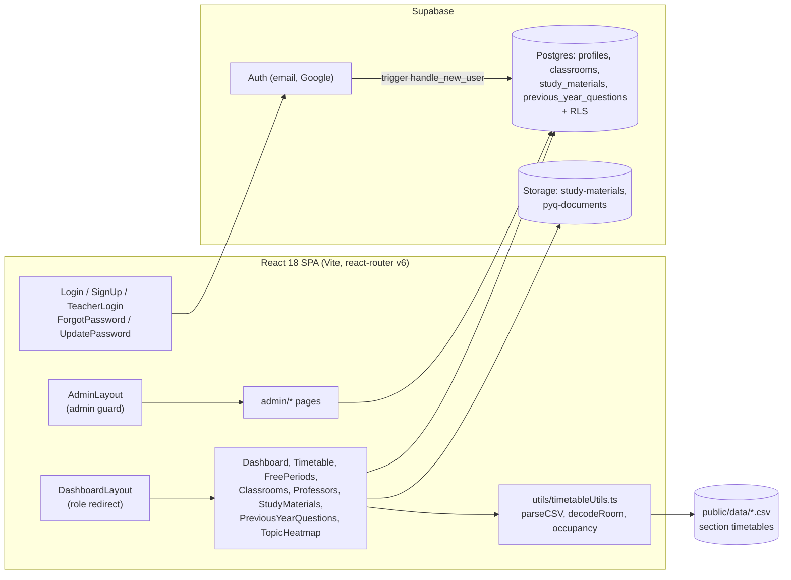

# Campus Hub Navigator

A campus companion web app for students, teachers and admins: section timetables, "who and which room is free right now", a classroom directory, crowd-sourced study materials and previous-year question papers, and an admin panel — a React single-page app backed by Supabase Auth, Postgres and Storage.


Status: college project, deployed on Vercel

## Overview

**Problem.** On a large campus the practical questions are mundane but constant: which classroom is empty this period, where is a particular professor right now, what does my section's week look like, and where are last year's question papers. The answers live in PDFs, WhatsApp groups and the department notice board.

**Solution.** Campus Hub Navigator loads the official per-section timetables (CSV exports), decodes room codes into block/floor/room, and derives free faculty and free rooms for any day and period. Alongside it, any signed-in student or teacher can upload study materials and previous-year papers to Supabase Storage so the whole batch can browse them by subject, unit, year and regulation. Admins get a dashboard to manage users, classrooms and uploaded content.

**Who it is for.** Built as a college project for a KL University batch (the shipped timetables are sections 23S01 to 23S04). Scaffolded with Lovable, then extended by hand.

## Key features

- **Role-based access** — `profiles.role` is `student` (default), `teacher` or `admin`. A Postgres trigger (`handle_new_user`) creates the profile at sign-up; `DashboardLayout` and `AdminLayout` read the role and redirect (`/admin` for admins, `/dashboard` otherwise). Google OAuth is offered next to email/password.
- **Free periods** — `src/pages/FreePeriods.tsx` fetches the four section CSVs from `public/data/`, parses them with `parseCSV`, and computes `getOccupiedFaculties` / `getOccupiedRooms` for the selected day and time slot, so free professors and rooms are the complement.
- **Room code decoding** — `decodeRoom('8609')` yields block 8, floor 6, room 09, used across the classroom and professor views.
- **Professors directory** — unique faculty list derived from the timetables with their current room and subject.
- **Classrooms** — the seeded `classrooms` table (room, building, capacity, type, amenities, `is_available`) merged with live occupancy from the timetables.
- **Study materials and PYQs** — `UploadMaterialDialog` / `UploadPYQDialog` upload the file to the `study-materials` or `pyq-documents` bucket, then insert a row with the public URL; lists are filterable by subject, unit, year, regulation and exam type.
- **Topic heatmap** — a colour-coded importance view of topics per subject (`TopicHeatmap.tsx`).
- **Admin panel** — counts dashboard, manage users (view roles, delete non-admins), full CRUD on classrooms, delete materials and PYQs.
- **Password recovery** — `resetPasswordForEmail` with a redirect to `/update-password`, which calls `auth.updateUser`.

## Architecture



| Component | Responsibility | Key files |
|---|---|---|
| Routing | Public auth routes, `/dashboard/*` and `/admin/*` nested layouts, 404 | `src/App.tsx` |
| Supabase client | Single `createClient` with `localStorage` session persistence | `src/integrations/supabase/client.ts` |
| Auth pages | Sign-in (student), teacher sign-in (auto-promotes `student` to `teacher`), sign-up with profile metadata, password reset | `src/pages/Login.tsx`, `TeacherLogin.tsx`, `SignUp.tsx`, `ForgotPassword.tsx`, `UpdatePassword.tsx` |
| Layout guards | Read `profiles.role` after `auth.getUser()`; redirect admins to `/admin`, non-admins away from it | `src/layouts/DashboardLayout.tsx`, `src/layouts/AdminLayout.tsx` |
| Timetable engine | CSV parsing, room decoding, unique faculties/rooms, occupancy per day/time | `src/utils/timetableUtils.ts` |
| Student pages | Feature screens listed above | `src/pages/*.tsx` |
| Upload dialogs | Storage upload + table insert with the current `user_id` | `src/components/UploadMaterialDialog.tsx`, `UploadPYQDialog.tsx` |
| Admin pages | Stats, users, classrooms CRUD, content moderation | `src/pages/admin/*.tsx`, `src/components/admin/AdminSidebar.tsx` |
| Database | Tables, RLS, trigger, seed | `supabase_setup.sql`, `supabase/materials_setup.sql`, `supabase/pyq_setup.sql`, `fix_admin_role.sql` |

### Data flow — "who is free now?"

1. `FreePeriods` mounts and `fetch`es `/data/23S0N_FULL_WEEK_TIMETABLE.csv` for each of the four sections.
2. `parseCSV` maps the columns `Section, Day, Period, Time, Subject, Faculty, Room, Class_Type` into `TimetableEntry[]`, decoding each room code.
3. The user picks a day and time slot (the day defaults to today).
4. `getOccupiedFaculties` and `getOccupiedRooms` filter entries for that slot; everything in `getAllUniqueFaculties` / `getAllUniqueRooms` not in those sets is shown as free.

### Data flow — uploading a study material

1. A signed-in user opens **Upload** on `/dashboard/materials` and fills title, subject, unit, type and file.
2. The file is uploaded to bucket `study-materials` (storage policy: `authenticated` insert where `auth.uid() = owner`).
3. The public URL is inserted into `study_materials` with `user_id = auth.uid()` (RLS insert policy).
4. The list refetches; everyone (even anonymous) can read rows and files.

### Data model (from the SQL files)

| Table | Purpose | Important columns | RLS |
|---|---|---|---|
| `profiles` | Role and display data per auth user | `id` (FK `auth.users`), `email`, `full_name`, `role` (`student`/`teacher`/`admin`) | Select: everyone. Insert/update: own row only |
| `classrooms` | Room directory, seeded with 10 rooms | `room_no`, `building`, `capacity`, `type`, `amenities text[]`, `is_available` | Select: everyone. Insert/update/delete: `profiles.role = 'admin'` |
| `study_materials` | Uploaded notes | `title`, `subject`, `unit`, `type`, `file_url`, `file_name`, `user_id` | Select: public. Insert: authenticated, own `user_id` |
| `previous_year_questions` | Uploaded papers | `subject`, `year`, `regulation`, `exam_type`, `file_url`, `file_name`, `user_id` | Select: public. Insert: authenticated, own `user_id` |

Trigger `on_auth_user_created` runs `handle_new_user()` (security definer) to insert a profile with `role = coalesce(raw_user_meta_data->>'role', 'student')`. Storage buckets `study-materials` and `pyq-documents` are public-read, authenticated-write.

## Tech stack

| Layer | Technology | Why |
|---|---|---|
| UI | React 18 + TypeScript, Vite 5 (SWC) | Fast HMR and typed components |
| Routing | react-router-dom 6 nested routes | Layout-level guards for `/dashboard` and `/admin` |
| Components | shadcn/ui on Radix, Tailwind CSS 3, lucide-react, sonner | Accessible primitives with a consistent design system |
| Forms | react-hook-form + zod | Validated sign-up and upload forms |
| Data fetching | @tanstack/react-query, supabase-js 2 | Caching plus a single client for auth, tables and storage |
| Backend | Supabase (Postgres, Auth, Storage, RLS) | No server to run; policies enforce roles in the database |
| Charts | Recharts | Dashboard visualisations |
| Hosting | Vercel (SPA rewrite in `vercel.json`) | Zero-config static deploy with client-side routing |

## Project structure

```
public/data/                    23S01..23S04_FULL_WEEK_TIMETABLE.csv (section timetables)
src/
  App.tsx                       routes
  integrations/supabase/        client.ts
  layouts/                      DashboardLayout.tsx, AdminLayout.tsx
  pages/                        Index, Login, SignUp, TeacherLogin, ForgotPassword, UpdatePassword,
                                Dashboard, Timetable, FreePeriods, Classrooms, Professors,
                                StudyMaterials, PreviousYearQuestions, TopicHeatmap, NotFound
  pages/admin/                  AdminDashboard, ManageUsers, ManageMaterials, ManagePYQs, ManageClassrooms
  components/                   UploadMaterialDialog, UploadPYQDialog, dashboard/ (Sidebar, TopNav), admin/, ui/
  utils/timetableUtils.ts       CSV parsing, room decoding, occupancy helpers
supabase_setup.sql              profiles, classrooms, trigger, seed, RLS
supabase/materials_setup.sql    study_materials table, bucket, policies
supabase/pyq_setup.sql          previous_year_questions table, bucket, policies
fix_admin_role.sql              backfill profiles and promote an email to admin
vercel.json                     SPA rewrite
```

## Getting started

### Prerequisites

- Node.js 18+ and npm (a `bun.lockb` is also committed if you prefer Bun)
- A Supabase project

### Install, configure, run

```bash
git clone https://github.com/karteyareddy/campus-hub-navigator.git
cd campus-hub-navigator
npm install
cp .env.example .env            # fill in the two values below
npm run dev                     # http://localhost:8080
```

Windows: `copy .env.example .env` in PowerShell; everything else is identical.

### Environment variables

| Name | Required | Description | Where to get it |
|---|---|---|---|
| `VITE_SUPABASE_URL` | Yes | Supabase project URL | Supabase: Project Settings, API |
| `VITE_SUPABASE_ANON_KEY` | Yes | Public anon key (RLS applies) | Supabase: Project Settings, API |

Both are embedded in the client bundle by Vite; never put a service-role key here. `.env` is git-ignored.

### Supabase setup

1. SQL editor: run `supabase_setup.sql` (profiles, classrooms, trigger, seed data).
2. Run `supabase/materials_setup.sql` and `supabase/pyq_setup.sql` (tables + storage buckets + policies).
3. Sign up once through the app, then run `fix_admin_role.sql` with your email substituted to promote yourself to `admin`.
4. Optional: enable the Google provider under Authentication > Providers and add `http://localhost:8080/dashboard` to the redirect allow-list.
5. Replace the CSVs in `public/data/` with your own sections, keeping the column order `Section,Day,Period,Time,Subject,Faculty,Room,Class_Type`.

## Usage

| Route | Who | What |
|---|---|---|
| `/login`, `/signup`, `/teacher-login` | Anyone | Email/password or Google sign-in; the teacher login promotes a `student` profile to `teacher` |
| `/dashboard` | Signed-in | Overview cards and quick links |
| `/dashboard/timetable` | Signed-in | Weekly grid by day and time slot |
| `/dashboard/free-periods` | Signed-in | Free faculty and rooms for a chosen day/period |
| `/dashboard/classrooms`, `/dashboard/professors` | Signed-in | Directories with live occupancy |
| `/dashboard/materials`, `/dashboard/pyq` | Signed-in | Browse, filter and upload notes / question papers |
| `/dashboard/heatmap` | Signed-in | Topic importance by subject |
| `/admin/*` | `admin` only | Stats, users, classrooms, materials, PYQs |

No HTTP API of its own: the app talks to Supabase directly with the anon key; row-level security is the authorisation layer.

## Security & privacy

- **Auth** — Supabase Auth (email/password with email verification, Google OAuth). Sessions persist in `localStorage` via supabase-js.
- **Authorisation** — enforced twice: in the UI by the layout guards, and in Postgres by RLS (`profiles` self-only writes; `classrooms` writes restricted to `admin` via a `profiles` subquery; uploads restricted to authenticated users inserting their own `user_id`).
- **Secrets** — only the public anon key ships to the browser; `.env` is git-ignored and was removed from history in the latest commit.
- **PII** — sign-up stores `full_name`, `mobile_number` and `gender` in auth user metadata and `profiles` exposes `email`/`full_name` to every reader (`select using (true)`). Uploaded files are in public buckets. Tighten both before using with real student data.

## Testing & quality

- `npm run lint` — ESLint 9 with `typescript-eslint`, `react-hooks` and `react-refresh` rules.
- `npm run build` — type-checks via Vite/SWC and produces `dist/`.
- No automated tests yet. `timetableUtils.ts` is pure and the natural first unit-test target.

## Deployment

Vercel: import the repo, set the two `VITE_*` variables, build command `npm run build`, output `dist`. `vercel.json` rewrites every path to `index.html` so deep links work with react-router. Any static host (Netlify, Cloudflare Pages) works the same way.

## Limitations & roadmap

- `Timetable.tsx` and `TopicHeatmap.tsx` render hard-coded sample data; only Free Periods, Professors and Classrooms use the real CSVs. Next step: drive the timetable grid from the same CSV parser and derive heatmap weights from the uploaded PYQs.
- `study_materials`, `previous_year_questions` and `profiles` have no `delete` RLS policy, so the admin delete buttons succeed in the UI but remove nothing; add admin delete policies (mirroring the `classrooms` pattern) to make moderation work.
- Anyone signed in can upload, and the teacher login promotes any account to `teacher`; there is no approval step.
- Timetables are static files in `public/data/`; moving them to a `timetable_entries` table would let admins edit them.
- Roadmap: admin-managed timetables, delete policies, private buckets with signed URLs, unit tests for `timetableUtils`.

## Acknowledgements / credits

- Supabase, shadcn/ui, Radix UI, Tailwind CSS, Recharts and lucide-react.
- Initial scaffold generated with Lovable.

**License:** No license file yet.

## Author

Kristipati Karteya Reddy — GitHub [@karteyareddy](https://github.com/karteyareddy)
